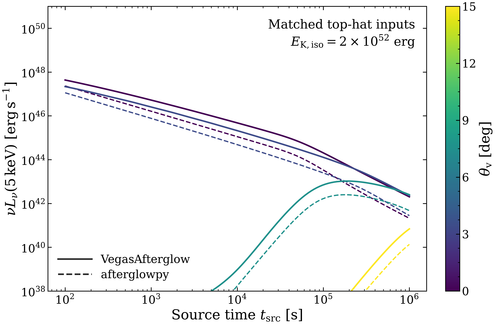
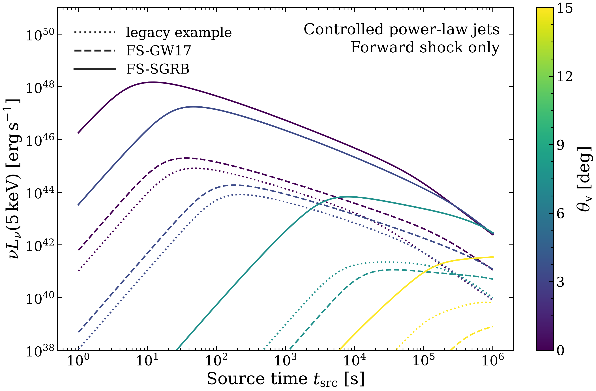

# Controlled afterglow checks

These curves use fixed published-style parameters, not a fitted population. Both figures show source-frame nu Lnu at rest 5 keV. Data below the displayed 1e38 erg/s limit remain in the full CSVs.

Solver ratios use 1e3 <= t_source <= 1e5 s and require both luminosities to be at least 1e38 erg/s. An empty row means there are no points meeting that comparison selection, not solver agreement.

| Viewing angle [deg] | Points | Median ratio | Minimum | Maximum |
| --- | --- | --- | --- | --- |
| 0 | 60 | 4.258 | 3.236 | 6.045 |
| 3.4 | 60 | 4.352 | 3.316 | 5.146 |
| 7.5 | 31 | 5.005 | 4.246 | 5.617 |
| 15 | 0 | -- | -- | -- |

The on-axis normalization differs by several-fold; agreement is not established. Finite-Lorentz-factor dynamics and radiation prescriptions need further comparison before treating the bright end as calibrated. No empirical normalization was applied. Rest-frame luminosity invariance under the redshift mapping was checked at z=0, 0.5 and 1.

